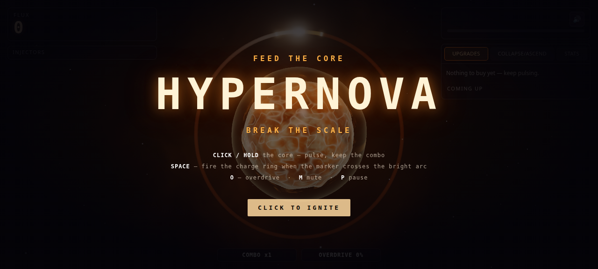
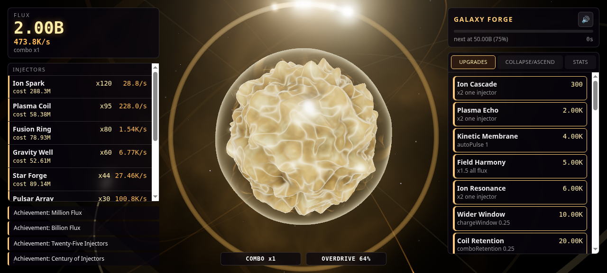
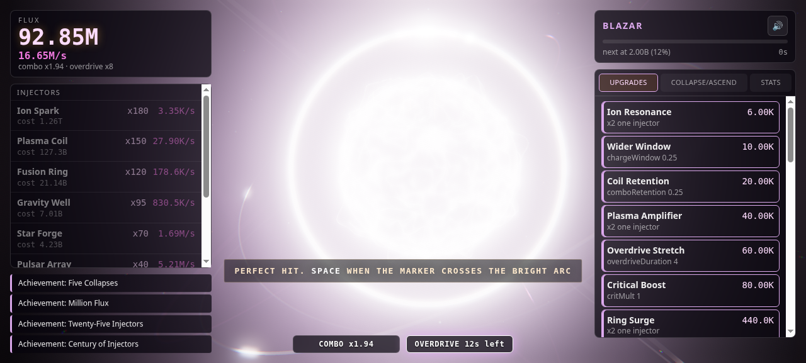

# HYPERNOVA

**Feed the core. Break the scale.**

An active 3D incremental game. Pulse a living star, nail the charge ring for critical surges,
ride overdrive, collapse the whole thing into shards, and ascend — while the numbers climb out of
notation entirely.

**Play it now: <https://burzaca.github.io/hypernova/>** (no install, no account, saves locally)





No textures, no sprites, no asset files: every visual is a procedural shader, every sound is
synthesised. Runs from a static folder — open `index.html` on any static server.

## Play

- **Click / hold the core** — inject a pulse. Keep the rhythm and your COMBO multiplier climbs.
- **SPACE / right-click** — fire the charge ring when the marker crosses the bright arc.
  Dead centre = PERFECT (×2, and the screen notices).
- **O** — trigger OVERDRIVE when the meter is full.
- **M** — mute. **P** — pause.

Progress is saved locally; offline production is credited when you come back.

## Why it is built this way

`docs/DESIGN.md` is the design document, including the **pacing contract** — the timings that keep
the game from going flat after five minutes. `tools/simulate.js` plays the game with a greedy bot
and fails CI if the contract is violated. Balance is measured, not hoped for. The current contract,
enforced in CI:

| By | Guaranteed |
|---|---|
| 0 s | first purchase |
| 16 s | first star form |
| 2 s | first overdrive |
| 1 min | 5 distinct star forms seen |
| 9 min | 9 forms seen |
| ~5 min | first collapse (never before 3 min) |
| ~31 min | first ascend |
| ~30 min | 13 forms seen — and the ladder continues for ever after that |
| always | something affordable within 90 s — no dead walls |

These numbers are measured against a **modelled human**, not a fictional one: the bot clicks at
6 CPS, which is the researched average sustained click rate (5–7 CPS for an ordinary person over
10–60 s — [cps-check.com](https://cps-check.com/),
[redragonshop.com/pages/cps-test](https://redragonshop.com/pages/cps-test); the 10-second world
record is ~12 CPS — [cpstest.org](https://cpstest.org/)). `node tools/simulate.js 3 42 3600 10`
checks the fast-player case; the ladder is deliberately insensitive to click rate past the first
few minutes. `tools/fit-stages.js` re-fits the ladder to target stage times whenever balance moves.

## The endgame does not run out

- **Endless stages.** Past the 15 hand-authored forms, `content.js` generates them forever — one
  new form per `GEN_STEP` (currently ×4) of lifetime flux, with names and palettes drawn from
  curated rings. `getStage(index)` is pure and total; a save at stage 30 reloads at stage 30.
  At most 3 forms fire per tick, so an ascend that multiplies flux by 1e5 reads as a cascade
  instead of fifteen events in one frame.
- **Ascension Boons.** Every ASCEND offers 3 boons and you keep one, permanently. Each one changes
  the *rules* and takes something away — "the core pulses itself 2×/s, overdrive peak is 3 lower",
  "huge crit weight, combo decays much faster". 16 boons, every one a trade, chosen deterministically
  from the save's own seed so a save reloads to the same offer. This is what stops a long run from
  feeling like the same run. The sim measures the cadence: **no player should ever go longer than
  `PACING.boonGapMax` (40 min, measured worst case 18m41s) without a new rule being offered** — CI
  enforces it.
- **A second injector family.** Six NOVA producers, unlocked by ascend count rather than flux, whose
  output scales with Nova Cores (`TUNE.prestige.novaPerCore`). This is what Cores are *for*, and it
  is why the shop says so out loud.

```bash
node --test tests/*.test.js      # contract tests for the economy, content tables, formatting
node tools/simulate.js 3 42 3600 # balance gate: times to every milestone, 3 seeds
node tools/curve.js 42           # the growth curve the stage ladder was fitted to
```

## Layout

```
src/core/     pure game logic — no DOM, no three.js, unit-tested in Node
  math.js format.js events.js tune.js   foundation + every balance knob
  content.js        injectors, upgrades, stages, perks, achievements (data)
  economy.js        state, production, combo, charge ring, overdrive, prestige, save
  audio.js          WebAudio synthesis, no files
src/render/   three.js — core plasma shader, charge ring, particles, bloom, camera
src/ui/       DOM overlay (hud.js) + styles/ui.css
src/main.js   the only file that wires state → render → UI → audio
tools/        run-worker.sh, simulate.js
docs/         DESIGN.md, INTERFACES.md, tasks/ (the work orders this build was assembled from)
```

`src/core/**` never imports `three` and never touches the DOM. That is what makes the economy
testable headless and the renderer replaceable.

## Credits

Built in one session by muha7a and Anakin, with implementation work delegated to Claude Opus 5.5
(economy, renderer) and free-tier agents (content, UI, audio) under a written interface contract.
Three.js r186. MIT.
